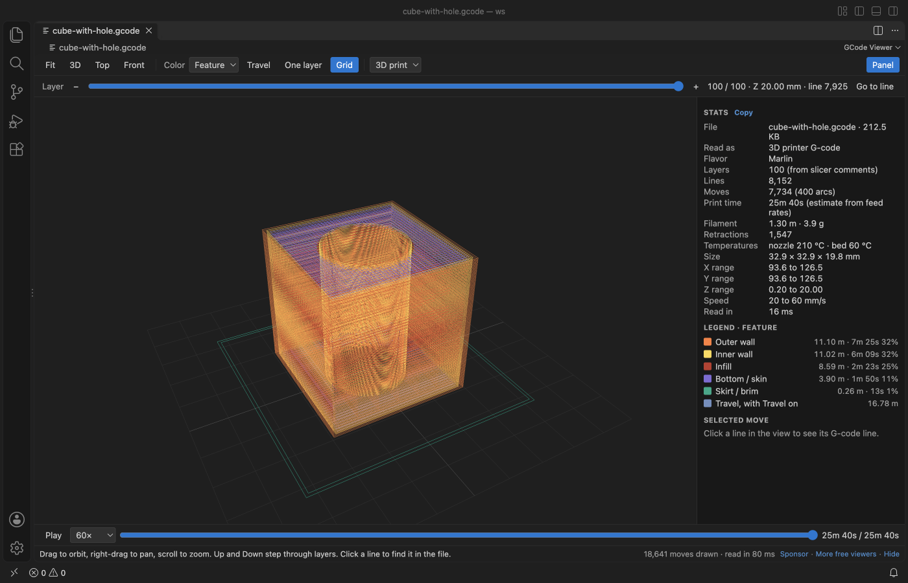
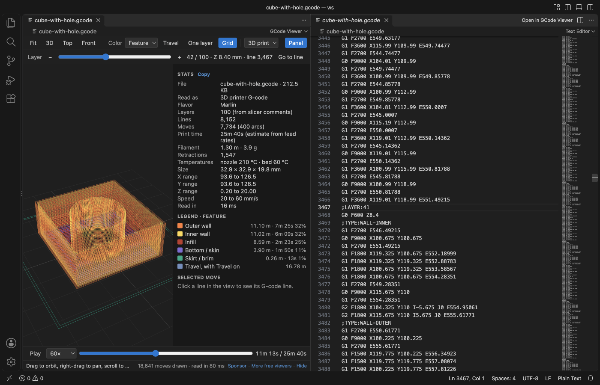
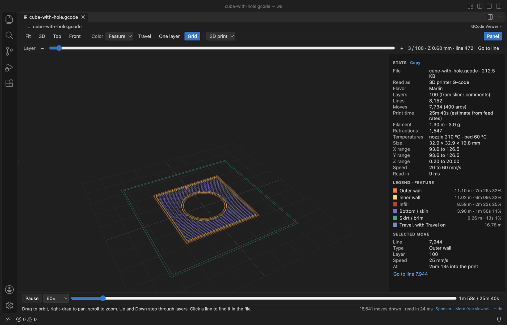
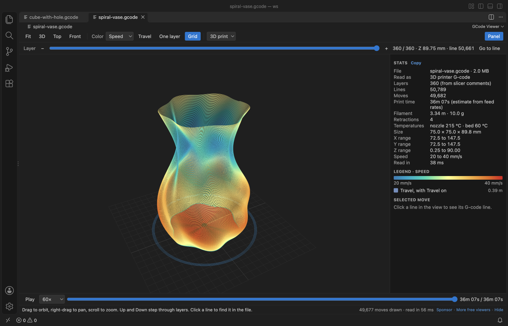
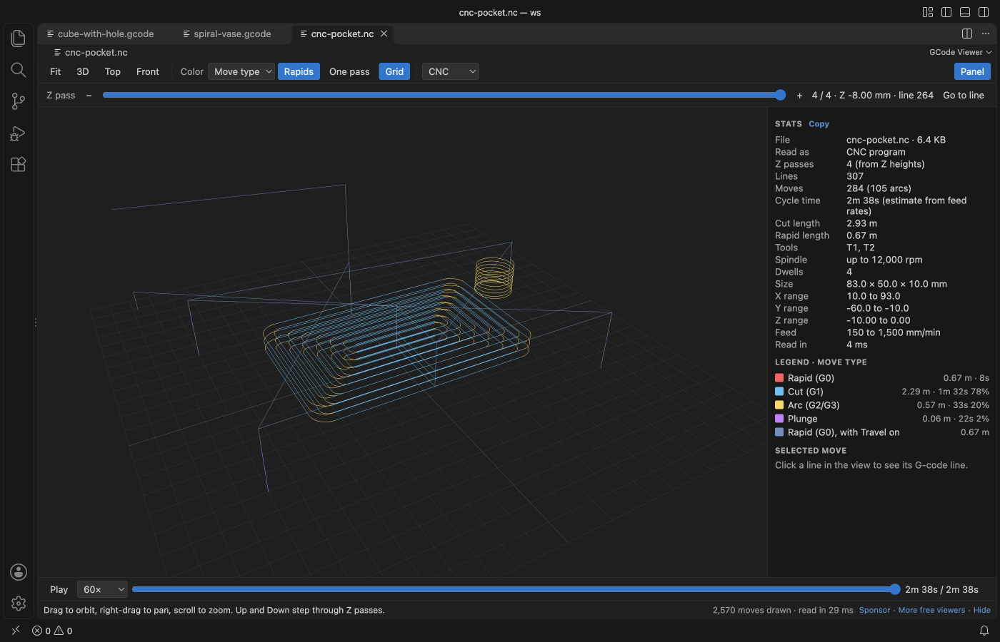

# GCode Viewer, CNC Viewer & 3D Print Preview

See your 3D printer or CNC G-code as a 3D toolpath in VS Code, layer by layer, and find the exact line behind any move.

*Screenshot of VS Code 1.142 with a cube print made by `scripts/make-samples.js`.*

- Check a slice before it goes to the printer. Walls, infill, skin, skirt and support each get a color, and the slider steps through every layer.
- Get the print time, filament length and weight, size and speeds from the file itself, next to the slicer's own estimate when the file has one.
- Click any move to see its line number, then open the text at that line. It works for CNC programs too, with G2 and G3 arcs and Z passes.

## Quick start

1. Install the extension.
2. Click a `.gcode` or `.gco` file in the Explorer. For `.nc`, `.g`, `.ngc`, `.tap` and `.cnc`, right-click the file and pick "Open in GCode Viewer".

## What you can do

| Action | How |
|---|---|
| Orbit, pan, zoom | Drag, right-drag, scroll. Fit, 3D, Top and Front in the toolbar. |
| Step through layers | The Layer slider, or the Up and Down keys. Home and End jump to the first and last layer. |
| Show one layer | One layer (or the S key). |
| Show travel moves | Travel (or T). In CNC mode the button is called Rapids and starts on. |
| Color the toolpath | Pick Feature, Speed or Layer in the Color menu. CNC files offer Move type, Feed rate, Z pass and Tool. |
| Play the print | Play (or Space) draws the moves in order with a nozzle marker, at 1× to 5000× speed. Drag the progress bar to seek. |
| Find a line | Go to line opens the text beside the preview at the first line of the layer. Click a move to see its line, then jump to it. |
| Copy the stats | Copy in the Stats panel. |

## What the stats show

- Layers (from slicer comments such as `;LAYER:`, `;LAYER_CHANGE` or `; CHANGE_LAYER`, or from Z heights when there are none), lines, moves and arcs.
- Print time estimated from the feed rate of every move, plus dwells. Acceleration is not modelled, so real prints often take a little longer. When the slicer wrote its own estimate (Cura `;TIME:`, PrusaSlicer, OrcaSlicer or Bambu Studio footers), it is shown too.
- Filament length from the E axis (absolute or relative) and the weight for the filament diameter and density in the settings.
- Size and X, Y and Z ranges of the printed part, the speed range, retractions and temperatures.
- In CNC mode the cycle time, cut and rapid lengths, the tools and the spindle speed.

## CNC mode

`.nc`, `.ngc`, `.tap` and `.cnc` files open in CNC mode, and so does any file with no extrusion. G0 rapids, G1 cuts, G2 and G3 arcs (I, J, K or R, helical arcs, G17, G18 and G19 planes) and plunges each get a color. Inches (G20), relative moves (G91), G92 and G28 are handled. The slider steps through Z passes. The 3D print / CNC menu reads the file again in the other mode.

NetCDF data files also end in `.nc`, so GCode Viewer does not take over `.nc` files by default. To open all your `.nc` files in it, right-click one, pick "Open With...", then "Configure default editor for '*.nc'..." and choose GCode Viewer. A `.nc` file that is really a NetCDF data file gets a short message and a button to reopen it in another editor.

## Big files

The file is read in a worker thread in 4 MB chunks, so VS Code stays responsive. In the release check a 59 MB file with 1.5 million moves was drawn 2.0 seconds after it was opened, and the workbench never took more than 30 ms to answer while it was read. Files over 500 MB show a message and are not read (setting `gcodeViewer.maxFileMB`). At most 5 million moves are drawn (setting `gcodeViewer.maxMoves`), while the stats still cover the whole file. The view reads the file again when it changes on disk, for example after the slicer exports it again.

## Settings

| Setting | Default | What it does |
|---|---|---|
| `gcodeViewer.mode` | `auto` | Read files as 3D print or CNC, or choose per file. |
| `gcodeViewer.filamentDiameter` | `1.75` | Filament diameter in mm for the weight estimate. |
| `gcodeViewer.filamentDensity` | `1.24` | Filament density in g/cm³ (PLA 1.24, PETG 1.27, ABS 1.04). |
| `gcodeViewer.rapidFeed` | `5000` | G0 speed in mm/min for the CNC time estimate. |
| `gcodeViewer.maxFileMB` | `500` | Largest file that is read. |
| `gcodeViewer.maxMoves` | `5000000` | Most moves drawn in 3D. |
| `gcodeViewer.askForRating` | `true` | Ask one time for a Marketplace rating after a few days of use. |
| `gcodeViewer.showSupportLinks` | `true` | Show the small Sponsor and More free viewers links under the view. |

## Privacy

Everything runs on your machine. The extension makes no network calls and has no telemetry. The webview runs under a strict Content Security Policy with no remote scripts, and comment text from the file is shown as plain text. The G-code file is never changed.

## Limits

- Lines are drawn 1 pixel wide, not as round extrusion tubes.
- Time estimates use feed rates only, without acceleration, jerk or firmware limits.
- Binary G-code (`.bgcode`) is not read. Export plain text G-code from the slicer instead.
- Picking a move uses the visible lines, so very dense views can pick a neighbour. Zoom in or use One layer for an exact pick.

## Support Zovo

Zovo extensions are free, with no ads and no tracking. They are made by [theluckystrike](https://github.com/theluckystrike) on GitHub. If this one saves you time, you can support the work:

- [Sponsor on GitHub](https://github.com/sponsors/theluckystrike)
- [Follow theluckystrike on GitHub](https://github.com/theluckystrike)

## More tools by Zovo

- [DXF Viewer & CAD Viewer for 2D Drawings](https://marketplace.visualstudio.com/items?itemName=zovo.dxf-viewer) opens ASCII and binary DXF drawings with layers, measuring and PNG or SVG export.
- [STL Viewer, OBJ Viewer, GLB & glTF Viewer](https://marketplace.visualstudio.com/items?itemName=zovo.3d-model-viewer) views GLB, glTF, STL, OBJ, PLY and 3MF models.
- [PDF Viewer & PDF Reader](https://marketplace.visualstudio.com/items?itemName=zovo.pdf-viewer-dark) reads PDFs with a real dark mode, search, an outline and thumbnails.

See [all Zovo extensions on the Marketplace](https://marketplace.visualstudio.com/publishers/zovo).

## License

MIT. three.js is MIT licensed, see THIRD-PARTY-NOTICES.md.

## More from zovo

- [All free zovo VS Code extensions](https://marketplace.visualstudio.com/publishers/zovo) — file viewers, database clients, formatters. Offline, no telemetry, no sign-up.
- [Full MCP server catalogue](https://theluckystrike.github.io/mcp/) — local-first MCP servers for back-office work: invoices, VAT, PDFs, spreadsheets, payroll.
- [Hosted no-install MCP endpoints](https://mcp.zovo.one) — paste a URL in Claude / Cursor, nothing to install.
